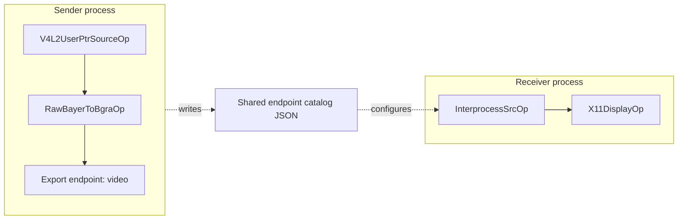

# Holoscan Interprocess Demo

This application demonstrates two processes exchanging live CUDA Tensor frames
through one Holoscan external endpoint.

The sender captures RAW10 frames with `V4L2UserPtrSourceOp`, converts them to
BGRA with `RawBayerToBgraOp`, and publishes them through the `video`
endpoint. The receiver imports that endpoint through `InterprocessSrcOp` and
displays it with `X11DisplayOp`.



## Build and validate

```bash
./holoscan_ridgerun build interprocess sender \
  --local --language cpp
./holoscan_ridgerun run interprocess validate \
  --local --language cpp --no-local-build
```

Validation compiles the sender graph and creates the endpoint catalog without
opening the camera.

## Run

Start the receiver in one terminal:

```bash
./holoscan_ridgerun run interprocess receiver \
  --local --language cpp --no-local-build \
  --run-args='--width 1920 --height 1080'
```

Start the sender in another terminal:

```bash
./holoscan_ridgerun run interprocess sender \
  --local --language cpp --no-local-build \
  --run-args='--device /dev/video0 --width 1920 --height 1080 --fps 60 --frame-limit 600'
```

Either process may be started first after the catalog exists. The sender waits
until the receiver has attached before counting or publishing camera frames.
When `--frame-limit` is reached, the sender publishes `sender_done` and the
receiver closes cleanly.

## Data behavior

The conversion operator writes into exportable CUDA storage. HoloMQ transfers
the allocation handle and metadata to the receiver. `InterprocessSrcOp` retains
the imported sample and forwards its Tensor handle, so no receiver-side frame
copy is introduced. `X11DisplayOp` performs the CUDA-to-host transfer needed
for X11 presentation.

When `HOLOSCAN_FLOW_TRACKING_LOG_FILE` is configured, the sender and receiver
emit events that the benchmark tooling merges into this path:

```text
camera -> convert -> interprocess_source -> display
```

Press `q`, Escape, close the display window, or use Ctrl-C to stop.
